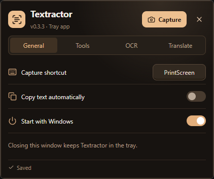
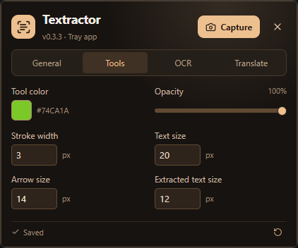
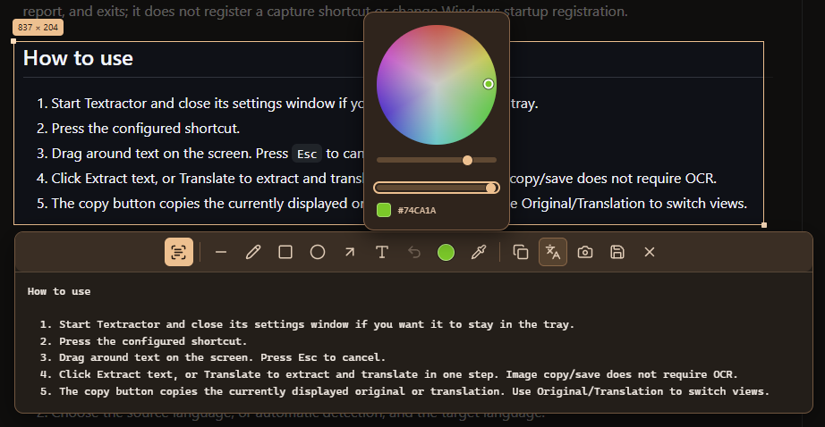

# Textractor

A lightweight Windows tray app for screen text extraction, annotations, offline translation, and recording.

**[Download the portable EXE](https://github.com/rtx1001/Textractor/releases/latest)** · ~7.5 MB · No installer

## Screenshots

<table>
  <tr>
    <td width="50%"></td>
    <td width="50%"></td>
  </tr>
</table>



## Features

- Capture text from images, videos, and unselectable interfaces with a customizable hotkey, including PrintScreen.
- OCR preserves text layout where possible; install only the recognition languages you need.
- Translate directly in the popup with optional offline language packs and automatic source detection. Switch between original and translated text.
- Draw lines, freehand strokes, rectangles, ovals, arrows, and movable/resizable text.
- Choose color, brightness, and opacity; use the eyedropper to copy a screen color's HEX code.
- Copy text or annotated images, or save captures as PNG.
- Copy buttons close capture after success. Save PNG hides capture while choosing a file; canceling returns to your edits.
- Adjust tool sizes and result text size; preferences are saved.
- Compact themed UI, tooltips, multi-monitor support, optional Windows startup, and single-instance protection.
- Screen recording: region/full monitor, 15/30/60 FPS, cursor toggle, system sound and microphone, pause/resume, and MP4 export.

## Quick start

1. Run `textractor.exe` and set your capture shortcut (default: `Ctrl+Shift+2`). Closing Settings keeps it in the tray.
2. Press the shortcut and drag to select a region.
3. Extract text, translate, annotate, or copy/save the image using the toolbar.

Mouse wheel adjusts tool size. `Ctrl+Z` undoes annotations. `Esc` turns off an active tool; press it again to close capture. Click outside to dismiss. Exit the app from its tray menu.

## Requirements and language packs

Windows 10/11 x64 (Intel/AMD) with Microsoft Edge WebView2 Runtime. No Node, Rust, or system Python is needed to run the app. The unsigned EXE may trigger a Windows publisher warning.

Install OCR languages in **Settings → OCR**. In **Translate**, choose source/target languages and click **Install language pack** when needed. Downloads are optional; installed packs work offline and captured text stays on your PC.

The shared translation engine uses ~150 MB installed, plus selected packs (e.g. Vietnamese → English ~80 MB). Settings and packs live in per-user AppData, not beside the EXE. Keep the EXE at a stable location for Windows startup. OCR accuracy varies; protected video may not capture.

**Screen recording:** in Settings → Recorder, approve the one-time ~115 MB FFmpeg download (~105 MB installed), then optionally enable system sound and/or the default microphone. Audio is off by default; microphone access needs Windows permission. Select a region and click the video icon, or choose Full screen. A faint click-through outline marks the area without dimming. The toolbar has Save (stops and exports), Minimize, and X (cancel); pause/resume is in the tray menu. Controls request Windows capture exclusion; hide them if they appear in your recording. Screenshot annotations are not recorded. Unsaved/canceled recordings remain under `%LOCALAPPDATA%\Textractor\recording\captures`; successful saves clean up temporary tracks.

Saved images/videos open in Explorer with the file selected. Existing files are never overwritten: duplicate names get `_000`, `_001`, etc.

## Build

Requires Windows, Node.js, Rust/MSVC build tools, and WebView2.

```powershell
npm ci
npm run tauri dev
# Portable build only
npm run tauri build -- --no-bundle
```

Output: `src-tauri/target/release/textractor.exe`.

Tests: `node testdata/translation-plan-tests.mjs` and `cargo test --lib` in `src-tauri`. Private OCR/model fixtures are not included. Third-party notices are in `public/ocr` and `src-tauri/VC-RUNTIME-NOTICE.txt`.
